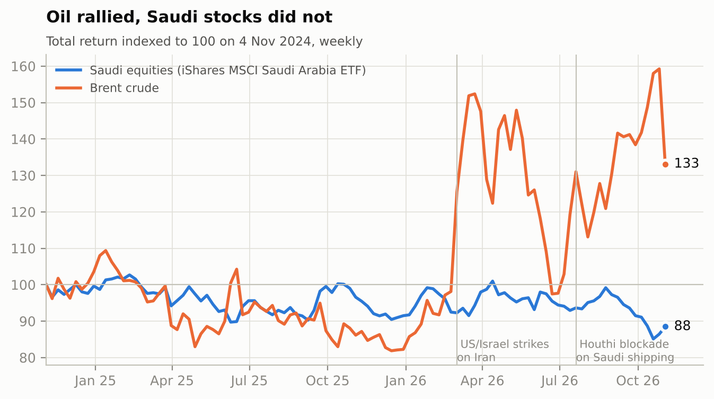
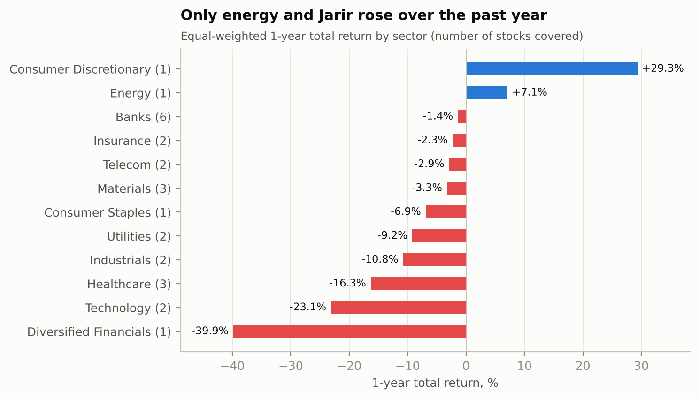
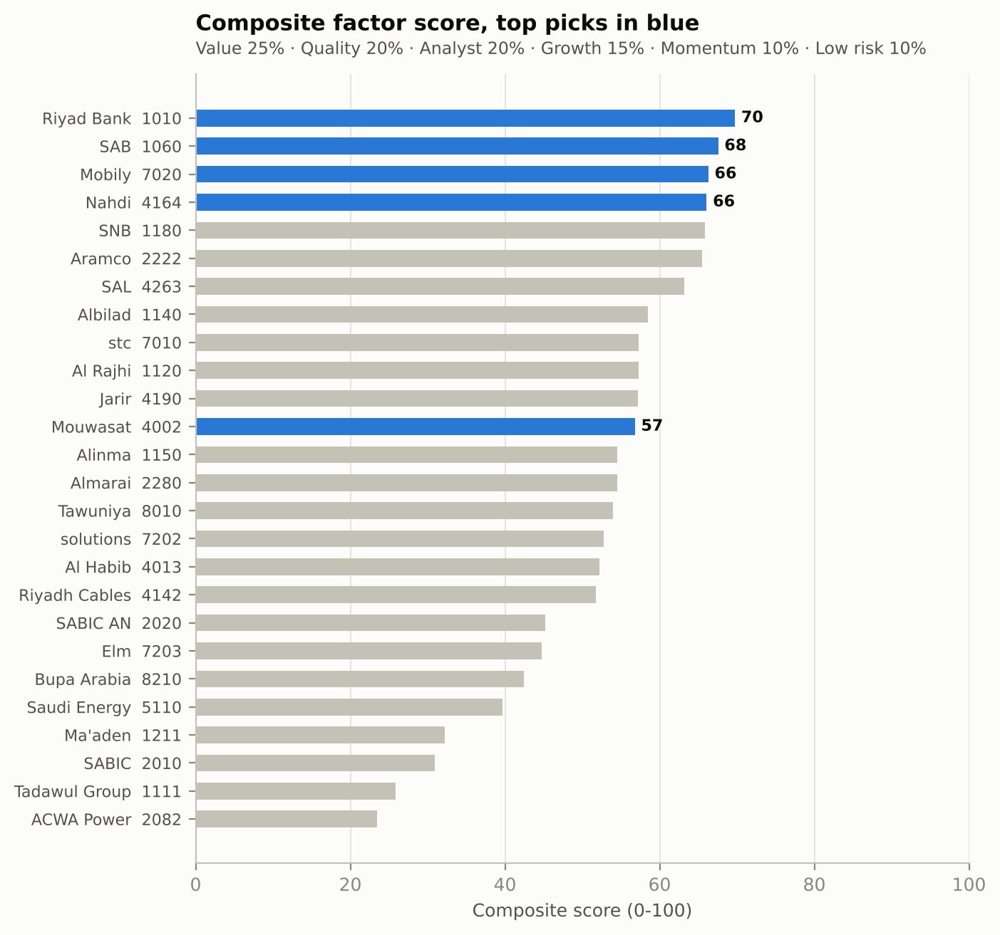
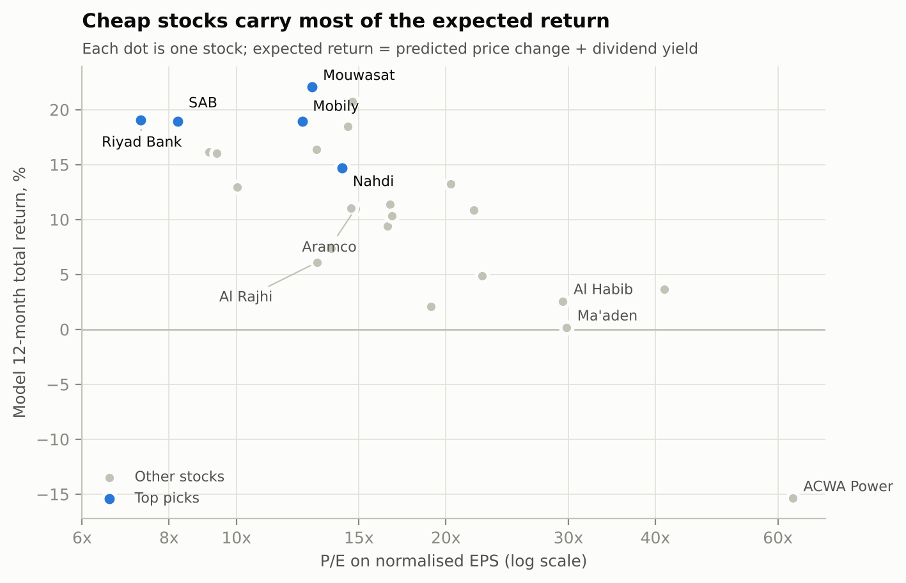
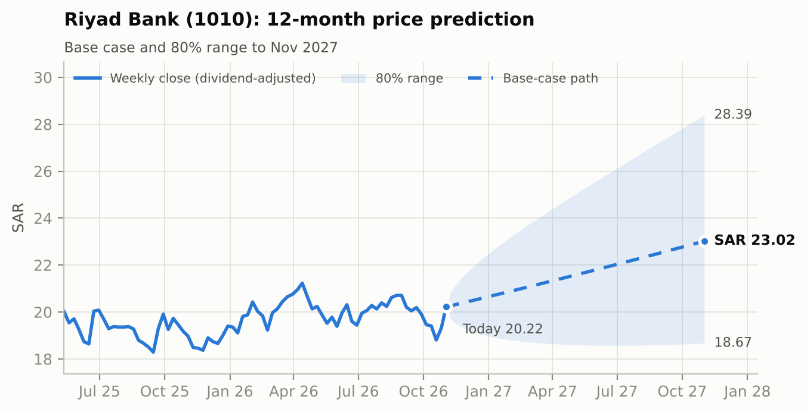
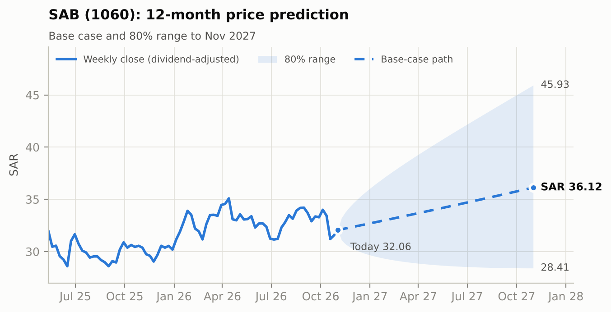
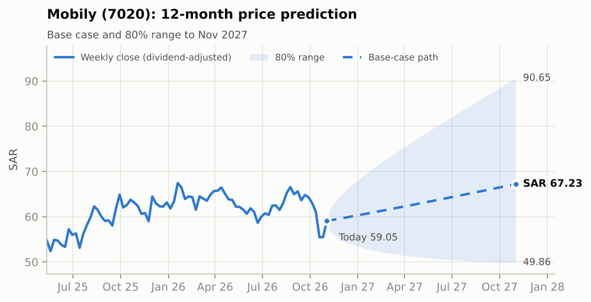
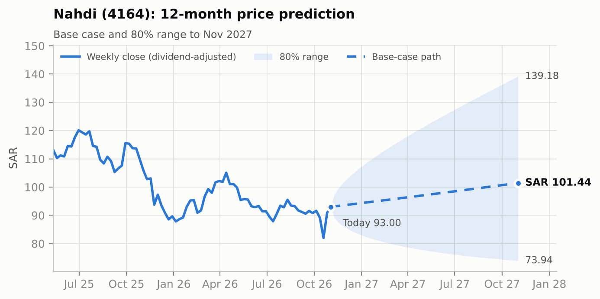
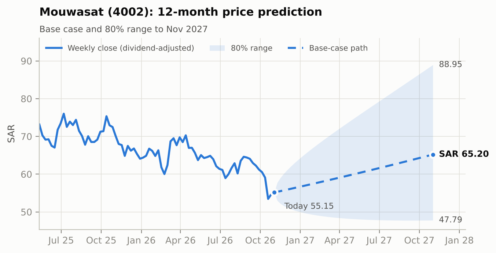

# Saudi Stock Market Report: Analysis, Top Picks and 12-Month Price Predictions

*Data as of the Tadawul close on 5 November 2026 · report date 7 November 2026 · universe: 26 large, liquid TASI stocks across 12 sectors*

> **Important:** this is a quantitative research report for information and education. It is not personalised investment advice. Price predictions are probabilistic estimates, not guarantees. Markets can move far outside the ranges shown, especially while the regional conflict continues. Check current prices and consider a CMA-licensed adviser before investing.

## 1. Summary

- **Market:** the TASI closed at **10,095** on 5 Nov 2026, about 10.6% lower than a year earlier. Over two years the KSA ETF (TASI proxy) returned **-11.5%** while Brent crude rose **+33.1%**. The market trades at about **13.6x** trailing earnings.
- **12-month TASI prediction:** base case **10,849** (+7.5%), with an 80% range of **8,762 - 13,432**; probability of being higher in 12 months: about 67%.
- **View:** **Cautiously positive, and selective.** Saudi shares are cheap after two losing years: about 13.6x trailing earnings, with many large companies yielding 5-6%. A lot of bad news is already in the price. But the market is hostage to the Iran conflict and the Red Sea blockade, and either can move prices 10% in a week. We favour **domestic, cash-generative, dividend-paying companies with little direct oil or shipping exposure**: value banks, telecoms and healthcare. We avoid expensive growth stories and Gulf-coast exporters whose shipments depend on the Strait of Hormuz.
- **Top 5 picks:** Riyad Bank (1010), SAB (1060), Mobily (7020), Nahdi (4164), Mouwasat (4002). As a model portfolio (weights in section 6), the model expects a **+18.7% total return** over 12 months, including a **5.3% dividend yield**, with estimated volatility of 17%.

| # | Stock | Sector | Price (SAR) | 12m target | Price chg | Div yield | Total return | 80% range (12m) | P(higher) | Rating |
| :--- | :--- | :--- | ---: | ---: | ---: | ---: | ---: | ---: | ---: | :--- |
| 1 | **Riyad Bank** (1010) | Banks | 20.22 | **23.02** | +13.8% | 5.2% | **+19.1%** | 18.67 - 28.39 | 79% | Buy |
| 2 | **SAB** (1060) | Banks | 32.06 | **36.12** | +12.7% | 6.2% | **+18.9%** | 28.41 - 45.93 | 74% | Buy |
| 3 | **Mobily** (7020) | Telecom | 59.05 | **67.23** | +13.8% | 5.1% | **+18.9%** | 49.86 - 90.65 | 71% | Buy |
| 4 | **Nahdi** (4164) | Healthcare | 93.00 | **101.44** | +9.1% | 5.6% | **+14.7%** | 73.94 - 139.18 | 64% | Buy |
| 5 | **Mouwasat** (4002) | Healthcare | 55.15 | **65.20** | +18.2% | 3.9% | **+22.1%** | 47.79 - 88.95 | 76% | Buy |

*12m target = model base-case (median) price in Nov 2027. Total return = price change + indicated dividend yield. 80% range = 10th-90th percentile of the predicted price.*

## 2. Market overview

| Indicator | Latest | Note |
| :--- | ---: | :--- |
| TASI | 10,095 | about -10.6% y/y, -4.6% over one month (Trading Economics) |
| KSA ETF 1y / 2y total return | -8.4% / -11.5% | USD; the riyal is pegged at 3.75 |
| KSA ETF volatility (1y) | 14.6% | annualised, weekly data |
| Market P/E (KSA ETF) | 13.6x | trailing |
| Brent crude | $98.3 | +54.5% over 1y; down about 15% in the week to 6 Nov |
| SAMA repo rate | 4.25% | follows the Fed because of the dollar peg |
| Real GDP 2026 / 2027 | -3.6% / +12.8% | Ministry of Finance (IMF: -3.3% / +7.9%) |
| 2027 budget deficit | 3.6% of GDP | spending SAR 1.392trn |

### What is driving the market

- **War and shipping disruption dominate 2026.** Brent crude jumped from about $65 to over $110 a barrel after US and Israeli strikes on Iran in early March. That followed months of disruption in the Strait of Hormuz. On 20 July the Houthis declared a maritime blockade on Saudi shipping, and Saudi crude loadings through Bab al-Mandeb fell to near zero; exports were rerouted via Suez. Brent peaked near $118 in late October, then fell about 15% in the week to 6 November, to $98.3, on hopes of a US-Iran deal. Tanker attacks have not stopped.
- **High oil prices did not help the stock market.** Over two years the KSA ETF (our TASI proxy) fell about 11% in total-return terms while Brent rose about 33%. Higher prices were offset by lost export volumes, attacks on facilities and a weaker non-oil economy. The TASI closed at 10,095 on 5 November: about 10.6% lower than a year earlier and 4.6% lower than a month earlier. That follows a 12.8% fall in 2025, its worst year in almost a decade.
- **The economy shrinks in 2026, with a rebound expected in 2027.** The Ministry of Finance expects real GDP to fall 3.6% in 2026 and rebound 12.8% in 2027; the IMF says -3.3% and +7.9%. The 2026 budget deficit is estimated at SAR 245bn, against SAR 165bn planned. The 2027 pre-budget statement plans spending of SAR 1.392trn and a deficit of 3.6% of GDP, funded by more borrowing. Government spending, the main driver of non-oil demand, stays under pressure.
- **Interest rates should fall.** The Saudi central bank (SAMA) repo rate is 4.25%, after three cuts in late 2025. Because the riyal is pegged to the dollar, SAMA follows the US Fed; local brokers expect further cuts. Lower rates trim banks' lending margins slightly, but they support share valuations, mortgages and consumer credit.
- **Q3 2026 earnings were resilient.** Combined Q3 bank profit rose about 4.8%: Al Rajhi +11.7% to a record SAR 7.1bn, Riyad Bank +6.6%, SNB -0.3%. Aramco's adjusted net income rose 9% to SAR 117bn, and free cash flow was SAR 105.8bn, despite attacks on its facilities. SAL +28%, Nahdi +6.6%, Mobily +1%, SAB +1%, Mouwasat -6%.
- **Market reforms could bring foreign money.** Since 1 February 2026 any foreign investor can buy Saudi shares directly; the old qualified foreign investor (QFI) regime is gone. The Capital Market Authority (CMA) is reviewing the 49% cap on foreign ownership; reports point to 75%. Morgan Stanley estimates $4.3-7.4bn of passive inflows, mostly into large banks with high free float.

| Sector | Stocks | 3m | 6m | 1y |
| :--- | ---: | ---: | ---: | ---: |
| Consumer Discretionary | 1 | -0.5% | +15.6% | +29.3% |
| Energy | 1 | -0.4% | -2.2% | +7.1% |
| Banks | 6 | -6.3% | -5.6% | -1.4% |
| Insurance | 2 | -10.0% | -11.6% | -2.3% |
| Telecom | 2 | -3.6% | -4.0% | -2.9% |
| Materials | 3 | -5.0% | -15.4% | -3.3% |
| Consumer Staples | 1 | -9.8% | +4.8% | -6.9% |
| Utilities | 2 | -13.5% | -11.1% | -9.2% |
| Industrials | 2 | -5.1% | -6.5% | -10.8% |
| Healthcare | 3 | -6.2% | -9.0% | -16.3% |
| Technology | 2 | -5.9% | -15.0% | -23.1% |
| Diversified Financials | 1 | -4.9% | -18.4% | -39.9% |

*Equal-weighted total returns of the stocks covered in each sector.*

## 3. Sector views

| Sector | Stance | Why |
| :--- | :--- | :--- |
| Banks | Overweight | About 9x earnings, 4.5-6% yields and steady profit growth. They benefit most if the foreign-ownership cap rises. We prefer cheap Riyad Bank and SAB to Al Rajhi, which trades at 3.1x book value and is priced for growth. |
| Healthcare | Overweight (selective) | Demand is structural: a growing, ageing population, compulsory health insurance and privatisation. Mouwasat (13x) and Nahdi (14x) have de-rated to attractive levels; Al Habib is high quality but already priced at about 29x. |
| Telecom | Overweight Mobily, Neutral stc | Defensive cash flows and about 5% yields, with little link to oil. Mobily is cheaper than stc: 12.4x earnings and 7.0x EV/EBITDA, against 14.6x and 9.5x. |
| Energy | Neutral | Aramco has record free cash flow and a 5.2% yield, but analysts expect lower earnings next year as oil prices settle. Good for income; limited upside. |
| Insurance | Neutral | Premiums are growing fast, but claims inflation is hitting profits: Tawuniya H1 -16% and Q2 -31%; Bupa's latest quarter -5%. |
| Consumer | Neutral | Jarir has momentum (+29% over a year) but is now fairly priced; Almarai has analyst support but negative free cash flow because of heavy capex. |
| Technology | Neutral | Elm and solutions by stc have de-rated (down 28% and 22% over a year) on tighter government IT budgets. Wait for clarity in the 2027 budget. |
| Industrials | Neutral | SAL is a high-quality growth company (Q3 profit +28%) but is fairly valued; Riyadh Cables is cheap, but its forward earnings are uncertain. |
| Materials | Underweight | SABIC's earnings are distorted and its ROE is close to zero; Ma'aden trades at about 30x with no dividend; SABIC Agri-Nutrients' Q3 profit fell 62.5%. They would rebound if Hormuz traffic normalised. |
| Utilities | Underweight | ACWA Power trades at 63x trailing earnings with negative free cash flow and 92% debt/equity; Saudi Energy has a 5% ROE and large negative free cash flow. |
| Diversified financials | Underweight | Saudi Tadawul Group's earnings fell 42% on lower trading activity, and the stock still trades at 41x. |

## 4. How the stocks were ranked

Each stock is ranked against the other 25 on six factors, using percentile ranks so that different units can be combined. The factors are then weighted into a 0-100 composite score:

| Factor | Weight | Signals |
| :--- | ---: | :--- |
| Value | 25% | earnings yield on normalised EPS, dividend yield |
| Quality | 20% | ROE (capped at 35%), debt/equity, positive free cash flow, payout below 100% |
| Analyst | 20% | upside to the consensus mean target, average recommendation |
| Growth | 15% | latest-quarter earnings growth, revenue growth, forward EPS growth |
| Momentum | 10% | 6-month total return, price vs 200-day average |
| Low risk | 10% | 1-year volatility, 2-year maximum drawdown |

### Full ranking

| Stock | Sector | Price | P/E* | Div yld | ROE | 1y TR | Analyst upside | Score | 12m target | 12m total return | Rating |
| :--- | :--- | ---: | ---: | ---: | ---: | ---: | ---: | ---: | ---: | ---: | :--- |
| Riyad Bank (1010) | Banks | 20.22 | 7.3x | 5.2% | 13% | +6.6% | +25% | 70 | 23.02 | +19.1% | Buy |
| SAB (1060) | Banks | 32.06 | 8.2x | 6.2% | 11% | +5.6% | +28% | 68 | 36.12 | +18.9% | Buy |
| Mobily (7020) | Telecom | 59.05 | 12.4x | 5.1% | 18% | -5.4% | +29% | 66 | 67.23 | +18.9% | Buy |
| Nahdi (4164) | Healthcare | 93.00 | 14.2x | 5.6% | 31% | -12.2% | +24% | 66 | 101.44 | +14.7% | Buy |
| SNB (1180) | Banks | 38.10 | 9.1x | 6.0% | 13% | +2.7% | +26% | 66 | 41.94 | +16.1% | Buy |
| Aramco (2222) | Energy | 26.16 | 14.8x | 5.2% | 25% | +7.1% | +16% | 65 | 27.67 | +11.0% | Hold |
| SAL (4263) | Industrials | 163.40 | 16.7x | 5.3% | 46% | +1.1% | +19% | 63 | 171.60 | +10.3% | Hold |
| Albilad (1140) | Banks | 21.10 | 9.4x | 4.7% | 14% | -23.5% | +31% | 58 | 23.49 | +16.1% | Buy |
| stc (7010) | Telecom | 41.62 | 14.6x | 5.3% | 17% | -0.5% | +15% | 57 | 44.01 | +11.0% | Hold |
| Al Rajhi (1120) | Banks | 62.00 | 13.1x | 4.1% | 19% | -6.1% | +18% | 57 | 63.26 | +6.1% | Hold |
| Jarir (4190) | Consumer Discretionary | 16.94 | 19.0x | 4.7% | 67% | +29.3% | +3% | 57 | 16.49 | +2.1% | Hold |
| Mouwasat (4002) | Healthcare | 55.15 | 12.9x | 3.9% | 23% | -21.4% | +44% | 57 | 65.20 | +22.1% | Buy |
| Alinma (1150) | Banks | 21.66 | 10.0x | 4.6% | 13% | +6.2% | +26% | 55 | 23.46 | +12.9% | Hold |
| Almarai (2280) | Consumer Staples | 43.10 | 16.6x | 2.7% | 12% | -6.9% | +29% | 54 | 46.86 | +11.4% | Hold |
| Tawuniya (8010) | Insurance | 88.75 | 20.3x | 1.5% | 19% | +3.0% | +44% | 54 | 99.15 | +13.2% | Hold |
| solutions (7202) | Technology | 91.55 | 14.5x | 4.4% | n/a | -19.6% | +37% | 53 | 104.44 | +18.4% | Hold |
| Al Habib (4013) | Healthcare | 215.80 | 29.5x | 2.5% | 30% | -15.4% | +23% | 52 | 215.85 | +2.6% | Hold |
| Riyadh Cables (4142) | Industrials | 98.70 | 13.0x | 4.6% | n/a | -22.7% | +26% | 52 | 110.35 | +16.4% | Hold |
| SABIC AN (2020) | Materials | 116.00 | 14.7x | 6.0% | 15% | +3.0% | +17% | 45 | 133.04 | +20.7% | Hold |
| Elm (7203) | Technology | 598.50 | 22.6x | 1.7% | 57% | -26.6% | +24% | 45 | 617.76 | +4.9% | Hold |
| Bupa Arabia (8210) | Insurance | 144.60 | 16.5x | 2.8% | 19% | -7.7% | +23% | 42 | 154.16 | +9.4% | Hold |
| Saudi Energy (5110) | Utilities | 15.67 | 13.7x | 4.5% | 5% | +12.2% | +5% | 40 | 16.12 | +7.4% | Hold |
| Ma'aden (1211) | Materials | 59.05 | 29.8x | 0.0% | 13% | -0.6% | +12% | 32 | 59.15 | +0.2% | Avoid |
| SABIC (2010) | Materials | 48.06 | 21.9x | 4.6% | 0% | -12.3% | +17% | 31 | 51.07 | +10.9% | Avoid |
| Tadawul Group (1111) | Diversified Financials | 112.00 | 41.2x | 2.1% | 9% | -39.9% | +33% | 26 | 113.81 | +3.7% | Avoid |
| ACWA Power (2082) | Utilities | 153.80 | 63.0x | 0.3% | 6% | -30.6% | -8% | 23 | 129.69 | -15.4% | Avoid |

*\*P/E on normalised EPS: the average of trailing and forward EPS when the forward figure passes the consistency checks, otherwise trailing EPS. Rating rules: **Strong Buy** = score >= 65 and 12m total return >= 20%; **Buy** = score >= 55 and total return >= 12%; **Avoid** = negative expected return or score < 35; otherwise **Hold**. Low-confidence data caps a stock at Hold.*

**Robustness check.** The factor weights were redrawn at random 2,000 times (each weight varies by roughly ±40%). Share of draws in which each pick ranks in the top 5 by score: Riyad Bank 96%, SAB 72%, Mobily 72%, Nahdi 78%, Mouwasat 2%. Mouwasat scores lower than the others: it is the next-highest-scoring Buy once the two-per-sector cap has excluded SNB and Bank Albilad, so treat it as the higher-risk pick.

## 5. Top 5 picks: why invest, and price predictions

Also rated Buy but left out by the two-per-sector cap: SNB (1180, 12m target SAR 41.94, total return +16.1%), Albilad (1140, 12m target SAR 23.49, total return +16.1%). These are good alternatives or additions.

### 1. Riyad Bank (1010): The cheapest large Saudi bank, with steady growth and a 5% yield

*Riyad Bank · Banks · Banks - Regional*

| Price | P/E | Div yield | ROE | 1y return | Volatility | Analysts | Score | Rating |
| ---: | ---: | ---: | ---: | ---: | ---: | ---: | ---: | :--- |
| SAR 20.22 | 7.3x | 5.2% | 13.3% | +6.6% | 14% | 16 (mean target 25.26) | 70/100 | Buy |

**Why invest**

- **Valuation:** about 7.3x normalised earnings and 1.21x book value for a 13.3% ROE. The bank median is about 9.3x.
- **Earnings:** Q3 2026 net profit rose 6.6% to SAR 2.87bn; 9M 2026 is up about 5% to SAR 8.13bn.
- **Income:** 5.2% dividend yield with a payout of only about 41%, which leaves room to raise dividends.
- **Low risk:** realised volatility of about 14%, the lowest of the six banks covered.
- **Support:** 16 analysts, average recommendation 1.75 (Buy), mean target SAR 25.3. A higher foreign-ownership cap would add buyers.

**Price prediction**

| Horizon | Base case (SAR) | Change | 80% range (SAR) |
| :--- | ---: | ---: | ---: |
| 3 months (Feb 2027) | **20.89** | +3.3% | 18.81 - 23.19 |
| 6 months (May 2027) | **21.57** | +6.7% | 18.60 - 25.02 |
| 12 months (Nov 2027) | **23.02** | +13.8% | 18.67 - 28.39 |

Building blocks: relative-value fair value **SAR 22.04** (fair P/E 7.9x) and haircut analyst target **SAR 24.00** (raw consensus 25.26). Expected 12-month total return **+19.1%**; probability the price is higher in 12 months: about **79%**.

**Risks:** Rate cuts squeezing lending margins; corporate loan losses if the downturn deepens; competition for government deposits.

### 2. SAB (1060): A bank priced below book value, with the highest yield among large banks

*Saudi Awwal Bank (SAB) · Banks · Banks - Regional*

| Price | P/E | Div yield | ROE | 1y return | Volatility | Analysts | Score | Rating |
| ---: | ---: | ---: | ---: | ---: | ---: | ---: | ---: | :--- |
| SAR 32.06 | 8.2x | 6.2% | 10.9% | +5.6% | 17% | 12 (mean target 41.14) | 68/100 | Buy |

**Why invest**

- **Valuation:** 0.97x book value and 8.2x earnings, the lowest price-to-book among the large banks covered.
- **Income:** about 6.2% dividend yield (SAR 2.0 a year), payout about 52%.
- **Earnings:** 9M 2026 net profit +3% to SAR 6.58bn; Q3 profit SAR 2.17bn (+1%), with operating income up about 5%.
- **Franchise:** strong corporate, trade-finance and wealth business with its HSBC affiliation.
- **Support:** 12 analysts, average recommendation 1.58 (Buy), mean target SAR 41.1.

**Price prediction**

| Horizon | Base case (SAR) | Change | 80% range (SAR) |
| :--- | ---: | ---: | ---: |
| 3 months (Feb 2027) | **33.03** | +3.0% | 29.29 - 37.25 |
| 6 months (May 2027) | **34.03** | +6.1% | 28.72 - 40.33 |
| 12 months (Nov 2027) | **36.12** | +12.7% | 28.41 - 45.93 |

Building blocks: relative-value fair value **SAR 33.38** (fair P/E 8.6x) and haircut analyst target **SAR 38.87** (raw consensus 41.14). Expected 12-month total return **+18.9%**; probability the price is higher in 12 months: about **74%**.

**Risks:** Lowest ROE of the picks (10.9%); earnings growth has slowed to low single digits; sensitive to rate cuts.

### 3. Mobily (7020): A defensive telecom at a discount to stc, yielding 5%

*Mobily (Etihad Etisalat) · Telecom · Telecom Services*

| Price | P/E | Div yield | ROE | 1y return | Volatility | Analysts | Score | Rating |
| ---: | ---: | ---: | ---: | ---: | ---: | ---: | ---: | :--- |
| SAR 59.05 | 12.4x | 5.1% | 18.3% | -5.4% | 22% | 13 (mean target 76.21) | 66/100 | Buy |

**Why invest**

- **Valuation:** 12.4x trailing earnings and 7.0x EV/EBITDA, against 14.6x and 9.5x for stc.
- **Earnings:** 9M 2026 net profit +7.7% to SAR 2.71bn; Q3 +1% to SAR 925m against a strong Q3 2025.
- **Returns and income:** 18% ROE and a SAR 3.0 dividend (about 5.1% yield).
- **Defensive:** telecom demand barely moves with oil; the stock is about 18% below its 52-week high.
- **Support:** 13 analysts, average recommendation 1.62 (Buy), mean target SAR 76.2.

**Price prediction**

| Horizon | Base case (SAR) | Change | 80% range (SAR) |
| :--- | ---: | ---: | ---: |
| 3 months (Feb 2027) | **61.00** | +3.3% | 52.53 - 70.83 |
| 6 months (May 2027) | **63.01** | +6.7% | 51.00 - 77.83 |
| 12 months (Nov 2027) | **67.23** | +13.8% | 49.86 - 90.65 |

Building blocks: relative-value fair value **SAR 62.54** (fair P/E 13.2x) and haircut analyst target **SAR 71.92** (raw consensus 76.21). Expected 12-month total return **+18.9%**; probability the price is higher in 12 months: about **71%**.

**Risks:** Q3 operating profit -3.3%; competition from stc and Zain; capex for 5G and data centres; current ratio below 1.

### 4. Nahdi (4164): High-return pharmacy leader with strong free cash flow

*Nahdi Medical · Healthcare · Pharmacy Retail*

| Price | P/E | Div yield | ROE | 1y return | Volatility | Analysts | Score | Rating |
| ---: | ---: | ---: | ---: | ---: | ---: | ---: | ---: | :--- |
| SAR 93.00 | 14.2x | 5.6% | 30.6% | -12.2% | 23% | 9 (mean target 115.52) | 66/100 | Buy |

**Why invest**

- **Quality:** 31% ROE and free cash flow of about SAR 0.93bn, a free-cash-flow yield of about 7.7%.
- **Recovery:** Q3 2026 net profit +6.6% to SAR 172m after an investment-heavy first half. Analysts expect 2027 EPS of about SAR 7.05 (+16%).
- **Income:** the latest semi-annual dividend of SAR 2.6 annualises to a 5.6% yield (3.3% trailing).
- **Structural growth:** non-cyclical consumer-health demand, plus growing clinics and online pharmacy.
- **Support:** 9 analysts, average recommendation 1.78 (Buy), mean target SAR 115.5.

**Price prediction**

| Horizon | Base case (SAR) | Change | 80% range (SAR) |
| :--- | ---: | ---: | ---: |
| 3 months (Feb 2027) | **95.04** | +2.2% | 81.14 - 111.33 |
| 6 months (May 2027) | **97.13** | +4.4% | 77.67 - 121.47 |
| 12 months (Nov 2027) | **101.44** | +9.1% | 73.94 - 139.18 |

Building blocks: relative-value fair value **SAR 93.00** (fair P/E 14.2x) and haircut analyst target **SAR 109.89** (raw consensus 115.52). Expected 12-month total return **+14.7%**; probability the price is higher in 12 months: about **64%**.

**Risks:** 9M 2026 profit is still down 4.9% and 2026 guidance is only +1-2%; margin pressure from expansion; online competition; drug-price regulation.

### 5. Mouwasat (4002): De-rated hospital operator: higher risk, highest upside of the picks

*Mouwasat Medical · Healthcare · Hospitals*

| Price | P/E | Div yield | ROE | 1y return | Volatility | Analysts | Score | Rating |
| ---: | ---: | ---: | ---: | ---: | ---: | ---: | ---: | :--- |
| SAR 55.15 | 12.9x | 3.9% | 22.6% | -21.4% | 23% | 13 (mean target 79.40) | 57/100 | Buy |

**Why invest**

- **Valuation:** about 13x trailing earnings (after Q3) against about 29x for Al Habib, despite a 22.6% ROE and modest debt (29% debt/equity).
- **Growth:** revenue still growing about 10%; 9M 2026 net profit SAR 600m (+2.7%). The Q3 dip (-6%) came from one-off collections in the comparison quarter.
- **Capacity:** the new Yanbu hospital should support margin recovery once it ramps up.
- **Entry point:** SAR 55.15, close to its 52-week low of 52.45 (high 74.25).
- **Support:** 13 analysts, average recommendation 2.23 (Buy), mean target SAR 79.4.

**Price prediction**

| Horizon | Base case (SAR) | Change | 80% range (SAR) |
| :--- | ---: | ---: | ---: |
| 3 months (Feb 2027) | **57.51** | +4.3% | 49.23 - 67.17 |
| 6 months (May 2027) | **59.96** | +8.7% | 48.14 - 74.69 |
| 12 months (Nov 2027) | **65.20** | +18.2% | 47.79 - 88.95 |

Building blocks: relative-value fair value **SAR 57.05** (fair P/E 13.3x) and haircut analyst target **SAR 73.34** (raw consensus 79.40). Expected 12-month total return **+22.1%**; probability the price is higher in 12 months: about **76%**.

**Risks:** Lower composite score than the other picks; HSBC downgraded it to Reduce in April 2026; start-up costs at new hospitals; slow collections from government payers.

## 6. Model portfolio

Weights are proportional to score divided by volatility, kept between 10% and 30%:

| Stock | Weight | 12m target | Expected total return | Div yield |
| :--- | ---: | ---: | ---: | ---: |
| Riyad Bank (1010) | 27% | 23.02 | +19.1% | 5.2% |
| SAB (1060) | 23% | 36.12 | +18.9% | 6.2% |
| Mobily (7020) | 18% | 67.23 | +18.9% | 5.1% |
| Nahdi (4164) | 17% | 101.44 | +14.7% | 5.6% |
| Mouwasat (4002) | 15% | 65.20 | +22.1% | 3.9% |
| **Portfolio** | **100%** |  | **+18.7%** | **5.3%** |

Estimated portfolio volatility: 17.1% (realised 15.1%, combined with an 8% conflict add-on). All five picks are domestic businesses whose profits depend on Saudi consumers, credit and rates. That keeps oil exposure low, but the basket is concentrated in banks and healthcare. Investors who want an oil hedge could add Aramco (Hold, 5.2% yield). Building positions in stages (for example, thirds over 2-3 months) reduces the risk of buying just before a geopolitical shock.

## 7. Quality holds and stocks to avoid

**Hold: good companies, limited upside at today's price**

| Stock | 12m target | Total return | Comment |
| :--- | ---: | ---: | :--- |
| Aramco (2222) | 27.67 | +11.0% | Income holding: 5.2% yield and record free cash flow, but analysts see lower EPS in 2027 as oil prices settle. |
| Al Rajhi (1120) | 63.26 | +6.1% | Best-in-class bank (Q3 profit +11.7%) but priced at 3.1x book; the model sees limited upside. |
| Al Habib (4013) | 215.85 | +2.6% | Top-quality hospital group (18% revenue growth) but about 29x earnings; buy on dips. |
| Jarir (4190) | 16.49 | +2.1% | Strong momentum and 67% ROE, but the price is already close to the analyst target. |
| SAL (4263) | 171.60 | +10.3% | Q3 profit +28% and 46% ROE; a great business at a fair price. Watch for pullbacks. |

**Avoid for now**

| Stock | Score | 12m target | Total return | Why |
| :--- | ---: | ---: | ---: | :--- |
| ACWA Power (2082) | 23 | 129.69 | -15.4% | 63x trailing P/E, negative free cash flow, 92% debt/equity, down 31% over a year. The valuation rests on a long-dated project pipeline. |
| Ma'aden (1211) | 32 | 59.15 | +0.2% | About 30x P/E, no dividend, and forward EPS below trailing. Its Gulf-coast export route depends on Hormuz. |
| Tadawul Group (1111) | 26 | 113.81 | +3.7% | Earnings -42% as trading volumes fell; still 41x trailing P/E. |
| SABIC (2010) | 31 | 51.07 | +10.9% | Earnings distorted by one-offs (negative TTM margin, ROE 0.4%); the payout ratio above 300% is not sustainable. |

## 8. TASI outlook: 12-month prediction

| Scenario | TASI in Nov 2027 | Change | What has to happen |
| :--- | ---: | ---: | :--- |
| Bull (90th pct) | 13,432 | +33.1% | A US-Iran deal reopens Hormuz and the Red Sea; Brent settles at $75-85 with full export volumes; SAMA cuts rates twice; the CMA lifts the foreign-ownership cap and foreign money flows into banks. |
| **Base (median)** | **10,849** | +7.5% | An uneasy stalemate: occasional attacks but no major escalation; Brent at $85-100; 2027 recovery broadly as the IMF expects; one or two rate cuts; earnings growth in the mid-single digits. |
| Bear (10th pct) | 8,762 | -13.2% | Renewed US strikes on Iran (Eurasia Group puts the odds at 60%), Brent at $110-125 but Saudi volumes disrupted again; deeper spending cuts; foreign selling. |

The base case uses the median predicted price change across the 26 stocks. The range uses the KSA ETF's realised volatility (14.6%) plus the conflict add-on. Other forecasts: Trading Economics' model sees about 9,160 in 12 months; SNB Capital expected 10,000-11,700 for 2026. Our base case sits between the two, and the wide range reflects how binary the geopolitics are.

## 9. Catalysts to watch

| Date | Event |
| :--- | :--- |
| 9 Nov 2026 | Q3 results due from Ma'aden, Saudi Energy and Jarir. |
| 10 Nov 2026 | US October CPI and the EIA Short-Term Energy Outlook (oil price path). |
| 11 Nov 2026 | OPEC Monthly Oil Market Report. |
| 16-17 Nov 2026 | Aramco Q3 dividend record/ex-date (SAR 0.3393 a share). |
| 29 Nov 2026 | OPEC+ ministerial meeting decides the 2027 production framework. |
| Mid-Dec 2026 | US Fed meeting; SAMA usually follows within hours. |
| Dec 2026 | Saudi 2027 budget approval; detail on spending priorities. |
| Ongoing | US-Iran talks, Houthi blockade and Hormuz shipping; CMA decision on the foreign-ownership cap. |

## 10. Methodology, assumptions and limitations

**Data.** Yahoo Finance quotes and fundamentals (snapshot of 5-6 Nov 2026) and two years of weekly dividend-adjusted prices for 26 stocks, the iShares MSCI Saudi Arabia ETF (KSA) and Brent futures, retrieved through Firecrawl. Yahoo's TASI history was unavailable, so the KSA ETF stands in for the index. News and company results come from the sources in section 11.

**Price model (per stock).**

1. *Relative-value fair value* = normalised EPS × fair P/E. The fair P/E moves 33% of the way from the stock's own P/E to its peer median: the sector median when the sector has at least 3 stocks, otherwise the median of all 26.
2. *Analyst view* = consensus mean target, keeping only 75% of the implied upside, because sell-side targets are optimistic on average.
3. *Base case (12-month median)* = 50% analyst view + 50% fair value, capped at -30% / +40%.
4. *Range* = log-normal distribution, with volatility = sqrt(1-year realised volatility² + 0.08²) for conflict regime risk. The 3- and 6-month figures lie on the same path, with the range scaled by sqrt(time).

**Selection rules.** Only Buy or Strong Buy ratings qualify; at most 2 per sector; average daily traded value of at least SAR 10m.

**Data adjustments.**

- Forward EPS is used only when it implies growth of -15% to +50% versus trailing EPS. Outside that band, Yahoo's forward figure is treated as unreliable (often stale or inconsistent with the latest results). This applies to SABIC, Ma'aden, Mobily, ACWA Power, solutions, Tawuniya, Tadawul Group, Riyadh Cables.
- solutions: Yahoo forward EPS (13.12) implies +107% growth vs TTM 6.33; inconsistent with flat Q3 earnings.
- SNB: Yahoo forward EPS (3.62) is below the 9M-2026 run-rate (~4.37 annualised); treated as stale.
- Mouwasat: trailing EPS updated to 4.19 and quarterly growth to -6% for Q3 2026 results published after the snapshot ([source](https://english.ajel.sa/business/o3x0al1qq)).
- SABIC (low-confidence data, so it cannot be rated above Hold): TTM profit margin is negative while TTM EPS is positive, and payout ratio is 323%: earnings are distorted by one-offs.
- ACWA Power (low-confidence data, so it cannot be rated above Hold): Trailing P/E of 63x and negative free cash flow; valuation rests on long-dated project pipeline.
- Tawuniya: one-week price spike on 2026-08-31 (136.00, reversed the next week) replaced with 92.67.

**Limitations.** Covers 26 large caps, not the whole market. Fundamentals come from a single free data source and some fields lag the latest results. Weekly data understates intraday risk. Analyst targets and recommendations are treated as information, not truth. The log-normal range assumes no jumps; a war escalation or a peace deal could move prices beyond it. Rerun the analysis after major news or earnings.

## 11. Sources

- [Trading Economics: TASI level and changes](https://tradingeconomics.com/saudi-arabia/stock-market)
- [Argaam: TASI steepest annual decline in a decade (2025)](https://www.argaam.com/en/article/articledetail/id/1869729)
- [SNB Capital 2026 TASI range (Argaam)](https://www.argaam.com/en/article/articledetail/id/1872101)
- [Marmore: Saudi outlook 2026](https://www.marmoremena.com/en/reports/macro-markets-gcc-saudi-arabia-outlook-january-2026/)
- [CNBC: Houthis declare maritime embargo on Saudi Arabia (20 Jul 2026)](https://www.cnbc.com/2026/07/20/iran-houthi-yemen-saudi-arabia.html)
- [The National: Saudi shifts oil exports to Suez](https://www.thenationalnews.com/business/energy/2026/07/26/saudi-arabia-shifts-to-suez-as-houthis-drive-bab-al-mandeb-oil-exports-to-near-zero/)
- [Al Jazeera: Saudi condemns Houthi blockade](https://www.aljazeera.com/news/2026/7/21/saudi-condemns-houthi-blockade-how-will-the-rest-of-the-world-be-impacted)
- [FinanceFeeds: Brent $98.32 week ahead](https://financefeeds.com/brent-crude-oil-price-98-32-saturday-week-ahead-us-iran-deal-bets-cpi-10-november-bull-105-bear-93/)
- [Vantage: Brent falls on midterms and Iran peace bets](https://www.vantagemarkets.com/market-analysis/why-brent-crude-oil-price-fell-midterms-iran-peace-bets-ukousd-usousd-november-6-2026/)
- [EIA Short-Term Energy Outlook](https://www.eia.gov/outlooks/steo/report/global_oil.php)
- [Arab News: 2027 budget deficit 3.6% of GDP](https://www.arabnews.pk/business/saudi-arabia-projects-2027-budget-deficit-at-36-of-gdp-3002797)
- [Zawya: Saudi fiscal deficit estimate 2027](https://www.zawya.com/en/economy/saudi-arabia-estimates-fiscal-deficit-of-3.6-of-gdp-in-2027-finance-ministry-says-1459338)
- [Trading Economics: SAMA interest rate](https://tradingeconomics.com/saudi-arabia/interest-rate)
- [Zawya: SAMA expected to follow Fed cuts](https://www.zawya.com/en/economy/gcc/saudi-central-bank-expected-to-toe-us-feds-possible-rate-cuts-of-100-bps-by-2026-end-report-x949op6l)
- [Arab News: Saudi banks Q3 profits](https://www.arabnews.com/finance/saudi-banks-q3-profits-rise-53-as-6-lenders-earn-53bn-3007508)
- [Maaal: Al Rajhi Q3 2026 profit +11.7%](https://maaal.com/en/news/details/al-rajhi-bank-q3-net-prof/)
- [Maaal: SNB Q3 2026 profit -0.29%](https://maaal.com/en/news/details/snbs-q3-profit-falls-02/)
- [Argaam: Riyad Bank 9M 2026 results](https://www.argaam.com/en/financial-reports/company-report/47/2026/72)
- [SAB: 9M 2026 net profit SAR 6.6bn](https://www.sab.com/en/about-us/newsroom/news-year-2026/saudi-awwal-bank-reports-sar-6-6-billion-net-profit-for-the-first-nine-months-of-2026-up-3-year-on-year/)
- [Maaal: Mobily Q3 2026 profit](https://maaal.com/en/news/details/mobily-q3-net-profit-rise/)
- [Decypha: Mobily 9M 2026](https://www.decypha.com/en/news/details/Mobily-s-net-profits-cross-SAR-2-7bn-in-9M-26--revenues-up-5-/21581428?L=EN)
- [Decypha: Nahdi 9M 2026](https://www.decypha.com/en/news/details/Nahdi-Medical-s-profits-near-SAR-623m-in-9M-26--revenues-jump-7-/21583197?L=EN)
- [Ajel: Mouwasat Q3 2026 profit -6%](https://english.ajel.sa/business/o3x0al1qq)
- [MarketScreener: Mouwasat analyst actions](https://uk.marketscreener.com/quote/stock/MOUWASAT-MEDICAL-SERVICES-10016654/)
- [QNA: Aramco Q3 2026 results and dividend](https://qna.org.qa/en/News-Area/News/2026-11/3/aramco-reports-9-rise-in-q3-adjusted-net-income-declares-sar-821-billion-dividend)
- [MEED: Aramco Q3 profit despite attacks](https://www.meed.com/aramco-q3-profit-rises-9-despite-attacks-on-facilities)
- [Maaal: SAL Q3 2026 profit +28%](https://maaal.com/en/news/details/sal-q3-net-profit-rises-2/)
- [MEIR: Tawuniya H1 2026 profit -16%](https://meinsurancereview.com/News/ViewNewsLetterArticle/id/96398/Type/MiddleEast/Saudi-Arabia-Tawuniya-1H-net-profit-falls-16-hit-by-higher-claims)
- [Franklin Templeton: Saudi opens markets to all foreigners](https://www.franklinresources.com/articles/2026/etf/saudi-arabia-opens-markets-to-all-foreigners)
- [Enterprise AM: foreign cap hike could bring $4.3bn](https://enterpriseam.com/ksa/2026/08/20/foreign-cap-hike-could-bring-usd-4-3-bn-to-tadawul/)
- [Yahoo Finance quotes and price history (via Firecrawl)](https://finance.yahoo.com/quote/%5ETASI.SR/)

---
*Generated by `run_analysis.py`. All tables and charts can be rebuilt from the data snapshot in `data/raw/`.*
